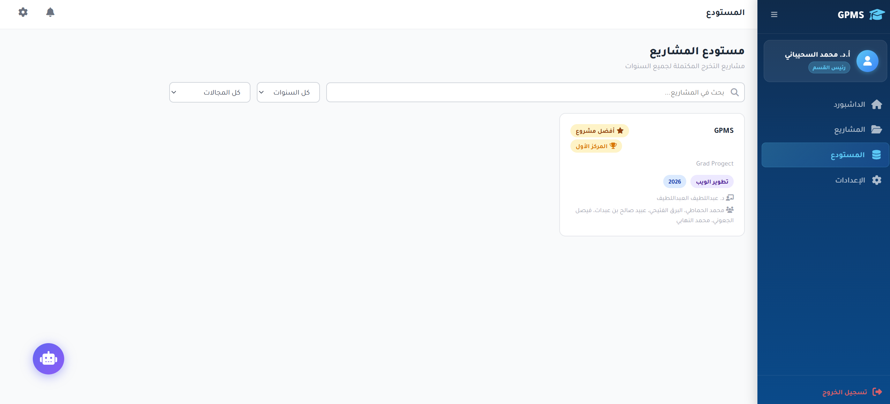

# GPMS — Graduation Project Showcase
## Project Overview
A public presentation website for a graduation project management system. This repository contains the showcase page and screenshots; it does not contain the runnable Laravel backend.

[View the showcase](https://albarq-cs.github.io/GPMS/)

## Problem Statement
Explain how a graduation project platform can organize student–supervisor coordination, requests, groups, and document workflows.

## Key Features
- Arabic, right-to-left project presentation.
- Feature sections illustrated with existing project screenshots.
- Technology and team sections.
- Responsive styling and scroll-triggered presentation effects.

## Technologies Used
HTML, CSS, vanilla JavaScript, and Google Fonts. Technology names shown inside the presentation describe the presented system and should not be confused with backend source included here.

## Architecture and Structure
| Path | Purpose |
| --- | --- |
| `index.html` | Standalone presentation page with embedded styling and scripts |
| `photos/` | Existing screenshots and presentation images |
| `README.md` | Repository scope and local viewing instructions |

## Installation and Configuration
No build step, database, or application credentials are required. Clone the repository and open `index.html`, or serve it locally:
```sh
python -m http.server 8000
```
Visit `http://localhost:8000/`. Keep `photos/` beside `index.html`. Google Fonts requires network access.

## Usage and Screenshots
Use the page to review the presented workflow and interface. Images in `photos/` are screenshots of the presented system, not proof of a backend running in this repository.



## Contribution and Attribution
The existing presentation includes team credits. This repository documents the public presentation of the work; it does not establish an exclusive implementation role for every system feature. Preserve the team attribution when reusing the presentation.

## Future Improvements
- Add a concise, verified individual-contribution breakdown.
- Add a walkthrough using sanitized demonstration data.
- Add descriptive alt text and review screenshot accessibility.
- Keep backend availability and the public presentation scope clearly distinguished.

## Author
[Albarq-CS](https://github.com/Albarq-CS), with team credits in the showcase.
